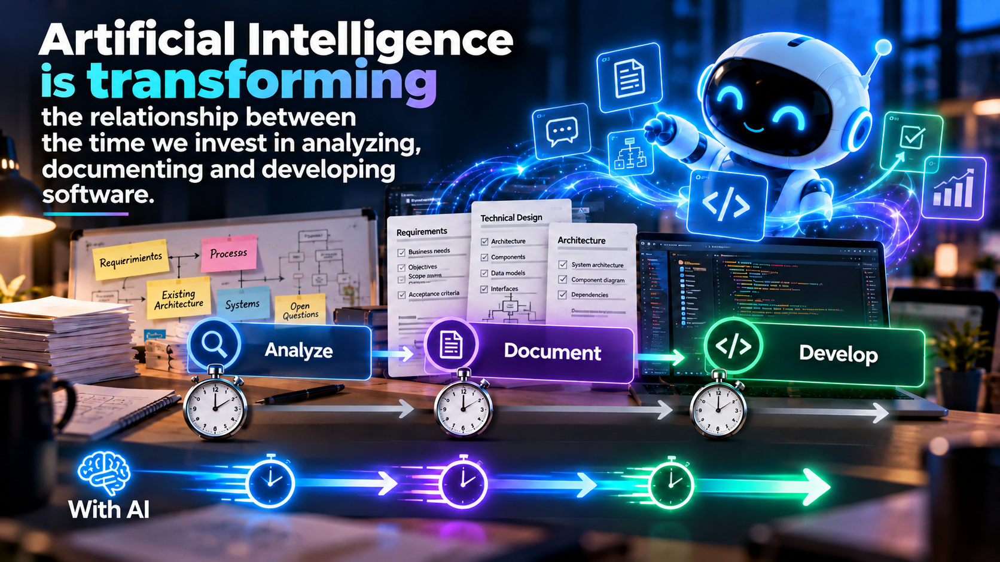
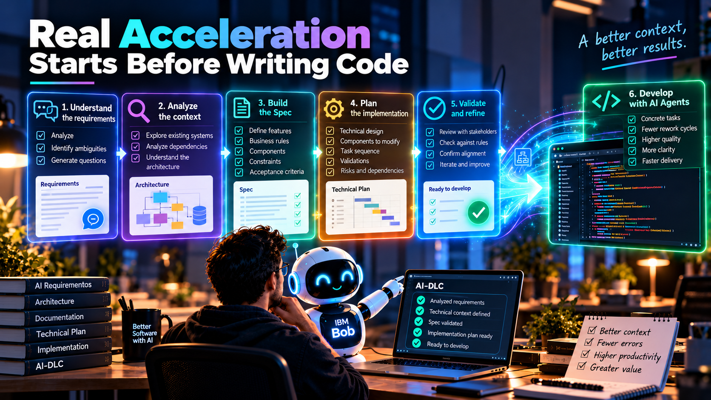

# Spec-Driven Development: when documentation accelerates development

**Part II — From SDLC to AI-DLC**

For many years, those of us who have worked in software development have had to balance two fundamental activities: **documenting and developing**. Analyzing requirements, designing architectures, creating technical specifications, and finally writing code are all important activities, but they all have one thing in common: they consume time, and time has always been one of the scarcest resources in our projects.

With the arrival of agile methodologies, we began to change the way we worked. We sought to deliver value more quickly, reduce activities that did not directly contribute to the product, and avoid overly bureaucratic processes.

But now we are experiencing another change:

> **Artificial Intelligence is changing the relationship between the time we invest in analyzing, documenting, and developing software.**

And from my perspective, this is making **Spec-Driven Development (SDD)** become enormously important within **AI-DLC (AI-Driven Development Lifecycle)**. Because we are discovering something very interesting:

> **In the agentic era, good documentation can become one of our greatest accelerators of development.**

<figcaption>Fig 1. AI is changing the relationship between time spent documenting and developing</figcaption>

## Did Agile teach us that documenting was bad?

For many years, we have heard interpretations like:

> **Let’s document the minimum and get to work.**

But I think it is important to understand where that way of thinking comes from. One of the values of the Agile Manifesto states that we should value working software more than exhaustive documentation. However, this never meant that documenting was bad or unnecessary. What we sought was to avoid documentation processes becoming obstacles to delivering value. Previously, building a complete technical specification could consume a considerable amount of time, and then we still needed to invest more time developing what we had documented. And many times, when we finally finished building the software, the requirements had already changed.

It was natural to seek ways to simplify the process, but this is where AI begins to change our perspective. Today we can use agents to analyze requirements, understand existing systems, generate documentation, and help us build technical specifications. And these same agents can later participate in the implementation of what we have specified.

> **We are no longer necessarily sacrificing development time to document better. We can use documentation to make our agents develop better.**

This is not about returning to bureaucratic processes or producing unnecessary documents; it is about understanding that the value of a specification has changed.

<figcaption>Fig 2. The real acceleration begins before we start developing</figcaption>

## Context remains the protagonist

In Part I of this series, we talked about how context changed the way we work with Artificial Intelligence. We went from autocomplete to prompting, and then to agents capable of analyzing their environment and using much broader information to perform tasks. But if we want to truly leverage these capabilities, we need to provide them with clear, structured, and reliable information. This is where documentation stops being just a deliverable and begins to become a fundamental component of the context in which our agents work.

A documented architecture helps the agent understand how our system is built, a well-defined functional requirement helps it understand what the business needs, organizational standards tell it how it should work, acceptance criteria define what it means for a feature to be correctly implemented, and a technical specification can connect all of these elements. In the end, I reduce it to a simple sentence:

> **The better we express our intention, the better conditions our agents have to help us turn it into software.**

## What changes with Spec-Driven Development?

For a long time, we have worked from requirements that later became development activities. At times, the information available was sufficient; in others, we began to develop and discovered ambiguities, incorrect assumptions, or technical details we had not considered.

With AI, these situations can take on a different dimension. An agent can generate code quickly, but if its context is incomplete or ambiguous, it can also quickly produce an implementation that does not respond correctly to what we need. That is why I believe **Spec-Driven Development should not be understood simply as documenting more before developing**. It should be understood as a way to build, organize, and validate the context our agents need in order to work. Instead of starting by requesting code through isolated prompts, we first seek to build a specification that clearly describes what we need to develop.

But there is something important:

> **A spec should not simply be a longer prompt.**

It should be the result of a process of analysis, understanding, and validation, a process in which humans and AI work together.

## Before the Spec, we need governance

In the first installment, we talked about something I consider fundamental:

> **AI-DLC does not begin with the requirement. It begins with governance.**

Before asking an agent to build a solution, we need to define how we want it to work. To do that, we need to establish a clear governance framework and define clearly:

- Our development standards.
- Our architectures.
- Our patterns.
- Our security rules.
- Our documentation conventions.
- Our validation processes.
- And our responsibilities.

With IBM Bob, we can use capabilities such as **Bob Rules** to establish instructions that guide its behavior within our projects. This allows us to separate two important concepts:

1. **Rules establish how we want to work.**
2. **The Spec establishes what we need to build and under what conditions.**

Both are necessary, because it is not enough for our agent to understand what we want to build; it also needs to know how it should do it within our organization. And although establishing this governance initially may require significant effort, we are building a knowledge base that we can reuse and improve continuously. For the next project, it should not have to start from scratch.

## First we need to understand the business

Once we have a governance base, we can begin working on the need we want to solve, and here again AI can participate long before development begins.

Functional requirements can contain subjective terms, ambiguities, invisible assumptions, or risks we do not identify initially. Instead of accepting a requirement as a static input to the process, we can work together with IBM Bob to analyze and question it. We can rely on requirement analysis frameworks, identify missing information, and generate questions that we need to resolve with the business. But there is something we must be clear about:

> **AI should not replace business decisions or invent answers we do not yet have.**

Its value at this stage is to help us identify what is missing, question what is unclear, and build a better understanding of the problem. Decisions must still be validated by the responsible people, and each answer allows us to continue enriching our context.

## From the functional requirement to technical understanding

Once we clearly understand the business need, we are still not ready to develop. We need to transform that functional requirement into something technically tangible:

- What do we have today?
- How does our application work?
- What components are involved?
- What architecture do we use?
- What dependencies exist?
- What code do we need to modify?
- What technical constraints do we need to consider?

This is where, from my perspective, agents can generate immense value. We can work with IBM Bob to analyze existing code, explore repositories, understand components, identify dependencies, and help us build or update technical documentation. But the important part is not only doing it faster.

> **Each analysis must enrich the context again.**

Now our agent can rely on information about the business need, functional requirements, our organizational standards, the Rules, the existing architecture, and the components that could be affected. We are progressively connecting business understanding with technical understanding, and that knowledge will be fundamental for the next stage.

## Building the Spec: when context takes shape

We then reach one of the most important moments in the process:

1. We have a refined functional requirement.
2. We have identified business needs.
3. We know our organizational rules.
4. We have analyzed the repository and existing components.
5. We understand the technical constraints.

Now we need to consolidate that knowledge, which is the foundation on which we begin to build our **Spec**. From my perspective, a good specification should allow us to clearly understand what we need to build, why we need it, how the solution should behave, and which conditions we must respect, without needing to produce giant documents. But we do need information that is sufficiently clear, complete, and verifiable for the scope we want to develop. And here IBM Bob can help us organize, analyze, and write that specification. But again, we must work together:

1. The human brings business knowledge, technical experience, architectural judgment, and responsibility for decisions.
2. AI brings the ability to analyze information, connect elements, identify possible omissions, and help structure the knowledge.

> **The Spec must be a joint construction between humans and AI.**

And before using it as a reference for implementation, it must be reviewed and validated by the responsible people.

## From the Spec to the technical implementation plan

Having a well-defined specification is a huge step forward, but we still need to decide how we are going to build the solution. And here we return to leveraging all the context we have been accumulating. With IBM Bob, we can work together to create a technical implementation plan, analyze which components require modification, identify dependencies, propose a sequence of activities, and consider the necessary validations.

But why do I consider this activity should be done jointly between humans and AI? Because at this point Bob already has relevant information about our standards, architecture, functional and technical requirements, and the solution we need to build.

This context allows us to compare the plan against the conditions previously defined, helping answer the following questions:

- Are we leaving any requirement out?
- Are we proposing something that contradicts our Rules?
- Is there any dependency we have not considered?
- Does the proposed design respect our architecture?
- Do the planned activities allow us to satisfy the acceptance criteria?

These are questions we can review together with the agent before starting to modify code, and here the human role remains fundamental:

> **AI can help us build and review the plan, but the human must validate that the plan truly responds to the project’s needs.**

In addition, the greater the risk of the development, the more rigorous our reviews and approvals should be. At the same time, maturity in AI does not mean removing controls; it means incorporating those controls consistently into the way we work.

## The real acceleration begins before writing code

At this point, someone might ask:

> **Are we adding too much work before we start developing?**

And I think this question reflects precisely the mindset shift we need. Previously, analyzing and documenting extensively could represent a significant additional effort, but today AI can assist us in many of these activities. Moreover, this initial work does not only produce documents:

> **It produces context that our agents can use during development.**

When we finally begin implementation, we already have a validated Spec, a technical plan, acceptance criteria, organizational rules, and a better understanding of the system. Instead of asking the agent to interpret everything from scratch, we can assign it concrete tasks based on information that has already been analyzed. This does not guarantee that errors, hallucinations, or rework will disappear, but it does allow us to establish better conditions to reduce them, detect them, and correct them. And here is the fundamental change:

> **We are not investing more time in documenting to delay development. We are using AI to document better and develop with greater clarity.**

Productivity no longer depends exclusively on how quickly we generate code and begins to depend also on how well we understand, specify, and plan what we need to build.

## The developer is also changing

This is where a particularly interesting transformation appears. For years, a large part of our work consisted of transforming requirements into code by analyzing a need, designing a solution, and then investing a significant amount of time implementing it.

With SDD and AI agents, this distribution of activities begins to change. We can now dedicate a larger proportion of our effort to understanding problems, analyzing systems, building specifications, defining architectures, and validating decisions, while relying on our agents to execute a significant part of the implementation tasks. This does not mean our technical knowledge loses value; quite the opposite:

> **Our experience becomes a fundamental tool for enriching the context that AI needs.**

You become a critical filter that helps AI make better decisions:

- Someone who understands architecture can identify a poor design decision.
- Someone who understands databases can challenge an inefficient query.
- Someone who understands legacy systems can recognize a critical dependency that is not obvious.
- And someone who understands the business can detect that a technically correct solution is not solving the right problem.

We are evolving toward professionals who can analyze, specify, and **orchestrate developments carried out with Artificial Intelligence**. And that does not make our responsibilities less important; it simply transforms them.

## The Spec must also evolve

There is something else I consider important: if during development we discover that a requirement was incomplete, that a technical constraint was not considered, or that an acceptance criterion was ambiguous, we should not limit ourselves to correcting the code. We also need to review our specification and ask ourselves the following questions:

1. Why did we not identify the problem earlier?
2. What information was missing?
3. Should we update the Spec?
4. Is there any Rule we need to improve?
5. Should we modify the technical plan?

This means SDD should not become another rigid process where we build a specification, approve it, and never revisit it again. The specification must evolve as we learn new things. But these changes must also be governed, reviewed, and validated.

> **The Spec is a living reference to the understanding we have of the solution, not a document we abandon when development begins.**

And here we reconnect with AI-DLC: each stage must allow us to learn, improve the context, and strengthen our process.

## The real change is not in documenting more, but in documenting better

I believe we are living in a very interesting moment in software engineering. For years we tried to optimize the time we spent documenting in order to develop faster, but now Artificial Intelligence allows us to rethink that relationship, because:

- We can analyze more information.
- We can create better specifications.
- We can identify ambiguities earlier.
- We can understand existing systems more quickly.
- And we can use that knowledge to guide the work of our agents.

But this does not mean we should return to producing unnecessary documentation. It means we must learn to create **useful, structured, verifiable, and reusable documentation**. Documentation that serves both people and AI agents and allows us to work toward a shared goal.

> **In the agentic era, documentation stops being only a description of the software and can become one of the main instruments for building it.**

## What comes next?

In the first installment, we talked about how context changed the way we work with AI. In this second part, we saw how we can transform that context into specifications that allow us to develop in a more structured way. Now:

- We have governance.
- We have Rules.
- We have refined requirements.
- We have technical context.
- We have a validated Spec.
- We have an implementation plan.

Then the next question appears:

> **What happens when we stop being the ones who execute every development task and begin directing specialized agents that execute them for us?**

Because in the agentic era, we do not necessarily need a single agent doing absolutely everything. We can work with specialized agents for development, architecture, databases, testing, and documentation, and that transforms our role as developers once again. We gradually stop being only those who write code and become **orchestrators of AI-generated development**.

But that will be part of our next conversation.

**To be continued...**

---

> **This is not only about modernizing code, but about modernizing the way we think and work.**
