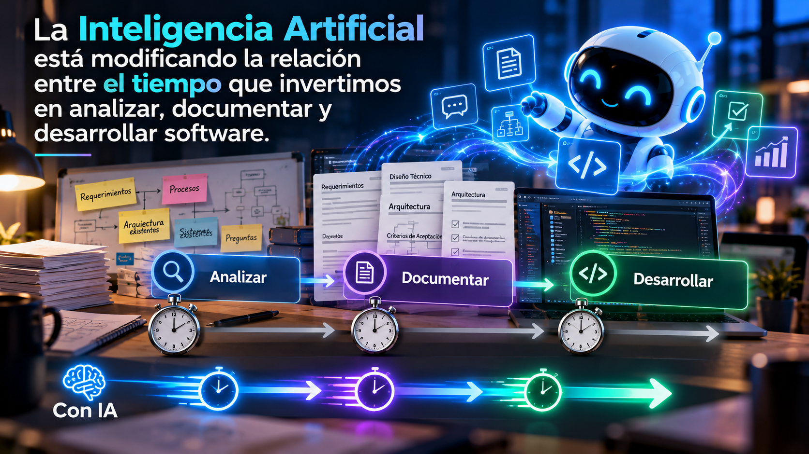
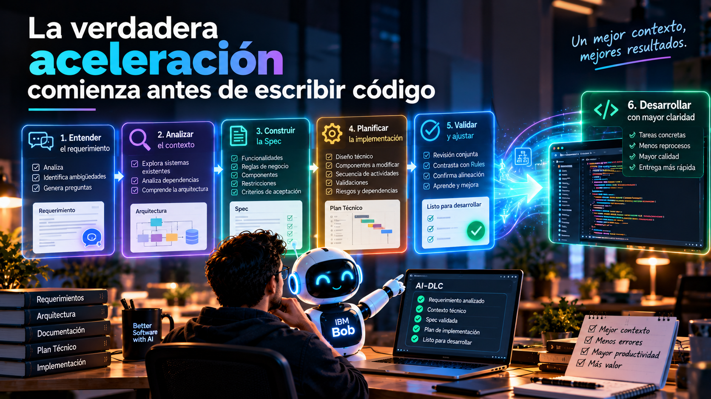

# Spec-Driven Development: cuando documentar acelera el desarrollo

**Parte II — Del SDLC al AI-DLC**

Durante muchos años, quienes hemos trabajado en desarrollo de software hemos tenido que buscar un equilibrio entre dos actividades fundamentales: **documentar y desarrollar**. Analizar requerimientos, diseñar arquitecturas, construir especificaciones técnicas y finalmente escribir código son actividades importantes, pero todas tienen algo en común: consumen tiempo, y precisamente el tiempo siempre ha sido uno de los recursos más limitados dentro de nuestros proyectos.

Con la llegada de las metodologías ágiles comenzamos a cambiar nuestra forma de trabajar. Buscábamos entregar valor más rápidamente, reducir actividades que no aportaran directamente al producto y evitar procesos excesivamente burocráticos.

Pero ahora estamos viviendo otro cambio:

> **La Inteligencia Artificial está modificando la relación entre el tiempo que invertimos en analizar, documentar y desarrollar software.**

Y desde mi perspectiva, esto está haciendo que **Spec-Driven Development (SDD)** adquiera una importancia enorme dentro de **AI-DLC (AI-Driven Development Lifecycle)**. Porque estamos descubriendo algo muy interesante:

> **En la era agéntica, una buena documentación puede convertirse en uno de nuestros mayores aceleradores del desarrollo.**

<figcaption>Fig 1. La IA está modificando la relación de tiempo entre documentar y desarrollar</figcaption>

## ¿Acaso Agile nos enseñó que documentar era malo?

Durante muchos años hemos escuchado interpretaciones como:

> **Documentemos lo mínimo y pongámonos a desarrollar.**

Pero creo que es importante entender de dónde viene esa forma de pensar, uno de los valores del Manifiesto Ágil establece que debemos valorar más el software funcionando que la documentación exhaustiva. Sin embargo, esto nunca significó que documentar fuera malo o innecesario. Lo que buscábamos era evitar que los procesos documentales se convirtieran en obstáculos para entregar valor. Antes, construir una especificación técnica completa podía consumir una cantidad considerable de tiempo y después necesitábamos invertir todavía más tiempo desarrollando aquello que habíamos documentado, y muchas veces, cuando finalmente terminábamos de construir el software, los requerimientos ya habían cambiado.

Era natural que buscáramos formas de simplificar el proceso, pero aquí es donde la IA comienza a cambiar nuestra perspectiva. Hoy podemos utilizar agentes para analizar requerimientos, comprender sistemas existentes, generar documentación y ayudarnos a construir especificaciones técnicas. Y esos mismos agentes pueden participar posteriormente en la implementación de lo que hemos especificado.

> **Ya no estamos necesariamente sacrificando tiempo de desarrollo por documentar mejor. Podemos utilizar la documentación para hacer que nuestros agentes desarrollen mejor.**

No se trata de regresar a procesos burocráticos ni de producir documentos innecesarios, sino de comprender que el valor de una especificación ha cambiado.

<figcaption>Fig 2. La verdadera aceleración comienza antes de que empecemos a desarrollar</figcaption>

## El contexto sigue siendo el protagonista

En la Parte I de esta saga hablamos sobre cómo el contexto cambió nuestra forma de trabajar con Inteligencia Artificial. Pasamos del autocompletado al prompting y posteriormente a los agentes, capaces de analizar su entorno y utilizar información mucho más amplia para realizar tareas. Pero si queremos aprovechar realmente esas capacidades, necesitamos proporcionarles información clara, estructurada y confiable. Aquí es donde la documentación deja de ser solamente un entregable, comienza a convertirse en un componente fundamental del contexto con el que nuestros agentes trabajan.

Una arquitectura documentada ayuda al agente a comprender cómo está construido nuestro sistema, un requerimiento funcional bien definido le permite entender qué necesita negocio, los estándares organizacionales le indican cómo debe trabajar y los criterios de aceptación permiten establecer qué significa que una funcionalidad esté correctamente implementada y una especificación técnica puede conectar todos estos elementos. Al final lo reduzco a una simple frase:

> **Mientras mejor expresamos nuestra intención, mejores condiciones tienen nuestros agentes para ayudarnos a convertirla en software.**

## ¿Qué cambia con Spec-Driven Development?

Durante mucho tiempo hemos trabajado a partir de requerimientos que posteriormente transformamos en actividades de desarrollo, en ocasiones, la información disponible era suficiente, y en otras, comenzábamos a desarrollar y descubríamos que existían ambigüedades, supuestos incorrectos o detalles técnicos que no habíamos considerado.

Con la IA, estas situaciones pueden adquirir una dimensión diferente, un agente puede generar código rápidamente, pero si su contexto es incompleto o ambiguo, también puede producir rápidamente una implementación que no responda correctamente a lo que necesitamos, por eso considero que **Spec-Driven Development no debería entenderse simplemente como documentar más antes de desarrollar**. Debería entenderse como una forma de construir, organizar y validar el contexto que nuestros agentes necesitan para trabajar. En lugar de comenzar solicitando código mediante prompts aislados, primero buscamos construir una especificación que describa claramente qué necesitamos desarrollar.

Pero hay algo importante:

> **Una Spec no debería ser simplemente un prompt más largo.**

Debería ser el resultado de un proceso de análisis, entendimiento y validación, un proceso en el que humanos e IA trabajan conjuntamente.

## Antes del Spec, necesitamos Gobierno

En la primera entrega hablamos sobre algo que considero fundamental:

> **AI-DLC no comienza con el requerimiento. Comienza con Gobierno.**

Antes de pedirle a un agente que construya una solución, necesitamos definir cómo queremos que trabaje y para esto necesitamos establecer un marco de gobierno claro y definir claramente:

- Nuestros estándares de desarrollo.
- Nuestras arquitecturas.  
- Nuestros patrones.
- Nuestras reglas de seguridad.
- Nuestras convenciones de documentación.
- Nuestros procesos de validación.
- Y nuestras responsabilidades.

Con IBM Bob podemos utilizar capacidades como **Bob Rules** para establecer instrucciones que orienten su comportamiento dentro de nuestros proyectos, esto nos permite separar dos conceptos importantes:

1. **Las Rules establecen cómo queremos trabajar.**
2. **La Spec establece qué necesitamos construir y bajo qué condiciones.**

Ambas cosas son necesarias, porque no basta con que nuestro agente entienda qué queremos construir, también necesita conocer cómo debe hacerlo dentro de nuestra organización y aunque establecer inicialmente este gobierno puede representar un esfuerzo importante, estamos construyendo una base de conocimiento que podremos reutilizar y mejorar continuamente. Para el siguiente proyecto no debería comenzar desde cero.

## Primero necesitamos entender el negocio

Una vez que tenemos una base de gobierno, podemos comenzar a trabajar sobre la necesidad que queremos resolver y aquí nuevamente la IA puede participar mucho antes de llegar al desarrollo.

Los requerimientos funcionales pueden contener términos subjetivos, ambigüedades, supuestos invisibles o riesgos que no identificamos inicialmente. En lugar de aceptar un requerimiento como una entrada estática al proceso, podemos trabajar junto con IBM Bob para analizarlo y cuestionarlo. Podemos apoyarnos en frameworks de análisis de requerimientos, identificar información faltante y generar preguntas que necesitamos resolver con negocio. Pero existe algo que debemos tener claro:

> **La IA no debería reemplazar las decisiones de negocio ni inventar las respuestas que todavía no tenemos.**

Su valor en esta etapa está en ayudarnos a identificar lo que falta, cuestionar lo que no está claro y construir una mejor comprensión del problema. Las decisiones deben seguir siendo validadas por las personas responsables y cada respuesta nos permite continuar enriqueciendo nuestro contexto.

## Del requerimiento funcional al entendimiento técnico

Una vez que comprendemos claramente la necesidad de negocio, todavía no estamos listos para desarrollar, necesitamos transformar ese requerimiento funcional en algo técnicamente tangible:

- ¿Qué tenemos actualmente?
- ¿Cómo funciona nuestra aplicación?
- ¿Qué componentes están involucrados?
- ¿Qué arquitectura utilizamos?
- ¿Qué dependencias existen?
- ¿Qué código necesitamos modificar?
- ¿Qué restricciones técnicas debemos considerar?

Aquí es donde, desde mi perspectiva, los agentes pueden generar un valor enorme. Podemos trabajar con IBM Bob para analizar código existente, explorar repositorios, comprender componentes, identificar dependencias y ayudarnos a construir o actualizar documentación técnica. Pero lo importante no es solamente hacerlo más rápido.

> **Cada análisis debe enriquecer nuevamente el contexto.**

Ahora nuestro agente puede contar con información sobre la necesidad de negocio, los requerimientos funcionales, nuestros estándares organizacionales, las Rules, la arquitectura existente y los componentes que podrían verse afectados. Estamos conectando progresivamente el entendimiento del negocio con el entendimiento técnico y ese conocimiento será fundamental para la siguiente etapa.

## Construyendo el Spec: cuando el contexto toma forma

Llegamos entonces a uno de los momentos más importantes del proceso:

1. Tenemos un requerimiento funcional refinado.
2. Hemos identificado las necesidades de negocio.
3. Conocemos nuestras reglas organizacionales.
4. Analizamos el repositorio y los componentes existentes.
5. Comprendemos las restricciones técnicas.

Ahora necesitamos consolidar ese conocimiento, que es la base sobre la cual comenzamos a construir nuestro **Spec**. Desde mi perspectiva, una buena especificación debería permitirnos comprender claramente qué necesitamos construir, por qué lo necesitamos, cómo debe comportarse la solución y cuáles son las condiciones que debemos respetar, sin necesidad de producir documentos gigantescos, pero necesitamos información suficientemente clara, completa y verificable para el alcance que queremos desarrollar. Y aquí IBM Bob puede ayudarnos a organizar, analizar y redactar esa especificación. Pero nuevamente debemos trabajar en conjunto:

1. El humano aporta conocimiento del negocio, experiencia técnica, criterio arquitectónico y responsabilidad sobre las decisiones.
2. La IA aporta capacidad para analizar información, relacionar elementos, identificar posibles omisiones y ayudar a estructurar el conocimiento.

> **El Spec debe ser una construcción conjunta entre humanos e IA.**

Y antes de utilizarlo como referencia para la implementación, debe ser revisado y validado por las personas responsables.

## Del Spec al plan técnico de implementación

Tener una especificación bien definida es un avance enorme, pero todavía necesitamos decidir cómo vamos a construir la solución. Y aquí volvemos a aprovechar todo el contexto que hemos venido acumulando. Con IBM Bob podemos trabajar conjuntamente en la elaboración de un plan técnico de implementación, podemos analizar qué componentes requieren modificaciones, identificar dependencias, proponer una secuencia de actividades y considerar las validaciones necesarias.

Pero ¿por qué considero que esta actividad debe realizarse conjuntamente entre el humano y la IA?, porque a este punto Bob ya dispone de información relevante sobre nuestros estándares, arquitectura, requerimientos funcionales y técnicos, así como sobre la solución que necesitamos construir.

Ese contexto le permite ayudarnos a contrastar el plan contra las condiciones previamente definidas, permitiendo responder a las siguientes preguntas:

- ¿Estamos dejando algún requerimiento por fuera?
- ¿Estamos proponiendo algo que contradice nuestras Rules?
- ¿Existe alguna dependencia que no hemos considerado?
- ¿El diseño propuesto respeta nuestra arquitectura?
- ¿Las actividades previstas permiten satisfacer los criterios de aceptación?

Estas son preguntas que podemos revisar junto con el agente antes de comenzar a modificar código y aquí el papel del humano sigue siendo fundamental:

> **La IA puede ayudarnos a construir y revisar el plan, pero el humano debe validar que ese plan realmente responde a las necesidades del proyecto.**

Además, cuanto mayor sea el riesgo del desarrollo, mayor debería ser el rigor de nuestras revisiones y aprobaciones, a la vez que la madurez en IA no significa eliminar controles, significa incorporar esos controles de manera consistente dentro de nuestra forma de trabajar.

## La verdadera aceleración comienza antes de escribir código

Llegados a este punto, alguien podría preguntarse:

> **¿No estamos agregando demasiado trabajo antes de desarrollar?**

Y creo que esta pregunta refleja precisamente el cambio de mentalidad que necesitamos. Antes, analizar y documentar extensamente podía representar un esfuerzo adicional considerable, pero hoy la IA puede asistirnos en muchas de esas actividades, además, ese trabajo inicial no solamente produce documentos:

> **Produce contexto que nuestros agentes podrán utilizar durante el desarrollo.**

Cuando finalmente comenzamos la implementación, ya tenemos una Spec validada, un plan técnico, criterios de aceptación, reglas organizacionales y un mejor entendimiento del sistema, en lugar de solicitarle al agente que interprete todo desde cero, podemos asignarle tareas concretas basadas en información previamente analizada. Esto no garantiza que desaparezcan los errores, las alucinaciones o los reprocesos, pero sí nos permite establecer mejores condiciones para reducirlos, detectarlos y corregirlos. Y aquí está el cambio fundamental:

> **No estamos invirtiendo más tiempo en documentar para retrasar el desarrollo. Estamos utilizando la IA para documentar mejor y desarrollar con mayor claridad.**

La productividad deja de depender exclusivamente de qué tan rápido generamos código y comienza a depender también de qué tan bien entendemos, especificamos y planificamos lo que necesitamos construir.

## El desarrollador también está cambiando

Aquí aparece una transformación que considero especialmente interesante, durante años, gran parte de nuestro trabajo consistió en transformar requerimientos en código, analizando una necesidad, diseñando una solución y posteriormente invirtiendo una cantidad importante de tiempo implementándola.

Con SDD y agentes de IA, esa distribución de actividades comienza a cambiar, ahora podemos dedicar una mayor proporción de nuestro esfuerzo a comprender problemas, analizar sistemas, construir especificaciones, definir arquitecturas y validar decisiones y podemos apoyarnos en nuestros agentes para ejecutar una parte importante de las tareas de implementación. Esto no significa que nuestro conocimiento técnico pierda valor, todo lo contrario:

> **Nuestra experiencia se convierte en una herramienta fundamental para enriquecer el contexto que necesita la IA.**

Te conviertes en un filtro crítico que ayuda a la IA a tomar decisiones más acertadas:

- Quien conoce arquitectura puede identificar una mala decisión de diseño.
- Quien conoce bases de datos puede cuestionar una consulta ineficiente.
- Quien conoce sistemas legacy puede reconocer una dependencia crítica que no resulta evidente.
- Y quien comprende el negocio puede detectar que una solución técnicamente correcta no está resolviendo el problema adecuado.

Estamos evolucionando hacia profesionales capaces de analizar, especificar y **orquestar desarrollos realizados con Inteligencia Artificial**. Y eso no hace que nuestras responsabilidades sean menos importantes, simplemente las transforma.

## El Spec también debe evolucionar

Hay algo más que considero importante, si durante el desarrollo descubrimos que un requerimiento estaba incompleto, que una restricción técnica no fue considerada o que un criterio de aceptación era ambiguo, no deberíamos limitarnos a corregir el código, necesitamos revisar también nuestra especificación y hacernos las siguientes preguntas:

1. ¿Por qué no identificamos el problema anteriormente?
2. ¿Qué información faltaba?
3. ¿Debemos actualizar el Spec?
4. ¿Existe alguna Rule que necesitamos mejorar?
5. ¿Debemos modificar el plan técnico?

Esto significa que SDD no debería convertirse en otro proceso rígido donde construimos una especificación, la aprobamos y nunca volvemos a revisarla, la especificación debe evolucionar cuando aprendemos algo nuevo. Pero esos cambios también deben estar gobernados, revisados y validados.

> **La Spec es una referencia viva del entendimiento que tenemos sobre la solución, no un documento que dejamos abandonado cuando comienza el desarrollo.**

Y aquí volvemos a conectar con AI-DLC, cada etapa debe permitirnos aprender, mejorar el contexto y fortalecer nuestro proceso.

## El verdadero cambio no está en documentar más, sino en documentar mejor

Creo que estamos viviendo un momento muy interesante en la ingeniería de software. Durante años intentamos optimizar el tiempo que dedicábamos a documentar para poder desarrollar más rápido, ahora la Inteligencia Artificial nos permite replantear esa relación, ya que:

- Podemos analizar más información.
- Podemos construir mejores especificaciones.
- Podemos identificar ambigüedades antes.
- Podemos comprender sistemas existentes con mayor rapidez.
- Y podemos utilizar todo ese conocimiento para orientar el trabajo de nuestros agentes.

Pero esto no significa que debamos volver a producir documentación innecesaria, significa que debemos aprender a construir **documentación útil, estructurada, verificable y reutilizable**. Documentación que sirva tanto a las personas como a los agentes de IA y que nos permita trabajar con un objetivo compartido.

> **En la era agéntica, la documentación deja de ser solamente una descripción del software y puede convertirse en uno de los principales instrumentos para construirlo.**

## ¿Qué viene después?

En la primera entrega hablamos sobre cómo el contexto cambió nuestra forma de trabajar con IA, en esta segunda parte vimos cómo podemos transformar ese contexto en especificaciones que nos permitan desarrollar de manera más estructurada, ahora:

- Tenemos gobierno.
- Tenemos Rules.
- Tenemos requerimientos refinados.
- Tenemos contexto técnico.
- Tenemos una Spec validada.
- Tenemos un plan de implementación.

Entonces aparece la siguiente pregunta:

> **¿Qué sucede cuando dejamos de ser quienes ejecutamos cada tarea de desarrollo y comenzamos a dirigir agentes especializados que las ejecutan por nosotros?**

Porque en la era agéntica no necesariamente necesitamos un único agente haciendo absolutamente todo. Podemos trabajar con agentes especializados en desarrollo, arquitectura, bases de datos, pruebas y documentación y eso transforma nuevamente nuestro papel como desarrolladores. Dejamos progresivamente de ser únicamente quienes escribimos código para convertirnos en **orquestadores de desarrollos generados por Inteligencia Artificial**.

Pero eso será parte de nuestra siguiente conversación.

**Continuará...**

---

> **No se trata solo de modernizar el código, sino de modernizar la forma en que pensamos y trabajamos.**
