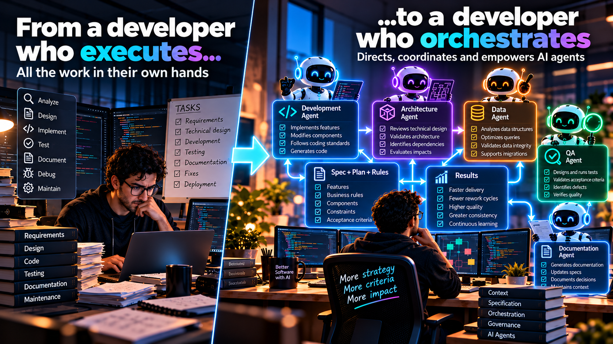
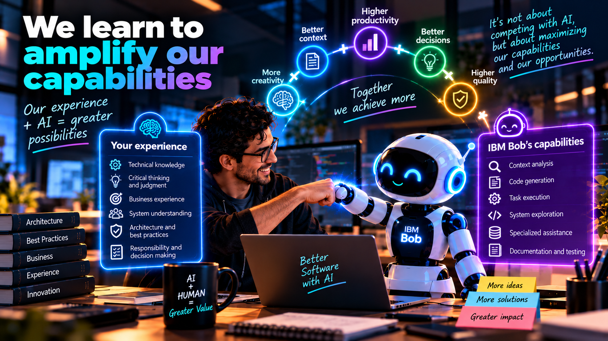

# The developer as orchestrator: working with AI agents in IBM Bob

**Part III — From SDLC to AI-DLC**

For many years, those of us who have worked in software development have built our experience by learning programming languages, architectures, databases, design patterns, and different technologies. We have devoted countless hours to analyzing problems, writing code, debugging errors, and finding solutions. And now we are living through a transformation that inevitably leads us to ask ourselves:

> **What happens to our role as developers when Artificial Intelligence begins to perform an important part of the activities we traditionally did ourselves?**

I think this is one of the most important questions we must ask ourselves in the agentic era, because when we talk about tools like IBM Bob, the conversation often revolves around how much code they can generate, how many tasks they can automate, or how much time they can save us. But from my perspective, we are facing a much deeper change:

> **It is not about competing with IBM Bob, but about maximizing our capabilities and possibilities.**

And to achieve that, we need to transform the way we work.

## It is no longer just about writing code

In the first installment of this series, we talked about how context changed the way we work with Artificial Intelligence, moving from autocompletion to prompting and later to the agentic era. In the second part, we explored how **Spec-Driven Development (SDD)** allows us to build specifications that enrich the context of our agents and guide development.

Now we reach a particularly interesting moment, where we have the following elements:

- We have a refined functional requirement.
- We have a technical understanding of our application.
- We have a validated Spec.
- We have an implementation plan.
- And we have Rules that establish the standards and conditions under which our AI must work.

Then a question arises:

> **Who should now execute the development activities?**

Traditionally, the answer was quite simple: **the developer**. But in the agentic era we begin to have another possibility: we can assign specific activities to our AI agents and accompany them during execution. This does not mean that development disappears; it means that **the activities we perform within development begin to change**, and with them, our responsibilities.

## From the developer who executes to the developer who orchestrates

For years, an important part of our work consisted of transforming requirements into code: we analyzed a need, designed a solution, and then implemented each of its components. With AI agents, we began to work in a different way.

Now we can dedicate a greater share of our effort to understanding the problem, analyzing the architecture, enriching the context, building specifications, and validating technical decisions. Meanwhile, we can rely on our agents to execute implementation activities. But here I want to emphasize something:

> **We are not ceasing to be responsible for development simply because AI is generating the code.**

Quite the opposite. Now we must ensure that what our agents generate appropriately responds to business needs, respects our architecture, and complies with the established quality standards. To do this, we need:

- Technical judgment.
- Knowledge.
- Experience.
- A new form of leadership within the development process.

In a way, **we become leaders of the developments generated by our AI agents**. We stop focusing exclusively on executing each task and begin directing how they should be executed. We are evolving toward a role as **orchestrators of development**.

<figcaption>Fig 1. From the developer who executes to the developer who orchestrates</figcaption>

## Our new coworker is an Artificial Intelligence

There is something I consider important when we talk about this transformation: we should not view IBM Bob as a competitor, nor should we think that the arrival of agents means that our knowledge and experience cease to be relevant. I believe we should begin to understand AI as a new member of our work environment, a **coworker** with whom we need to learn to collaborate. For years, we have worked in teams where each member contributes different knowledge, capabilities, and experiences. Now we are adding a new participant, and our programming partner may be an Artificial Intelligence.

This changes the dynamics of the work. It is no longer just about writing instructions so that a tool produces code; it is about learning to work jointly with an agent, provide it with context, set objectives, review its proposals, question its decisions, and validate its results.

> **AI can execute activities, but we remain responsible for steering development toward the correct outcome.**

And to do that, we need to learn new forms of collaboration.

<figcaption>Fig 2. Let’s learn to amplify our capabilities alongside AI</figcaption>

## Technical experience does not lose value: it changes where we apply it

Imagine a developer with 15 or 20 years of experience, someone who has worked for years with Java, RPG, SQL, software architecture, systems integration, and solving complex problems. It is natural for them to ask:

> **If IBM Bob can now generate code, what happens to everything I learned during my career?**

My answer would be simple:

> **That experience is precisely one of the capabilities we need to leverage Artificial Intelligence more effectively.**

Because an agent can generate a solution, but we still need technical judgment to determine whether that solution is appropriate. We can use our experience to enrich the context we provide to AI and apply it to achieve:

- Better Specs.
- Identification of architectural constraints.
- Questioning technical decisions.
- Detecting risks.
- Establishing Rules.
- And validating that the result truly responds to business needs.

An experienced developer does not only know the syntax of a language; they also know the consequences of certain decisions, understand why certain patterns exist, recognize problems they have faced before, and know that a solution may work technically without necessarily being the best solution for a system.

> **All that knowledge gains new value when we use it to guide the work of our agents.**

It is not about unlearning everything we know; it is about learning to use that knowledge in a different way.

## IBM Bob and specialized agents

This is where the concept of specialized agents becomes particularly interesting. When we talk about software development, we know that not all activities require exactly the same knowledge:

1. A developer specialized in IBM i may have deep knowledge of RPG and the particularities of that platform.
2. A Java developer may master other frameworks, architectures, and patterns.
3. A database specialist may understand aspects that are not necessarily part of the main knowledge of an application developer.
4. A QA professional can contribute a different perspective on how to validate a solution.

And this raises the question: **Why should we expect a single agent to execute all these activities under the same perspective?**

In IBM Bob we can work with different modes and specialized capabilities. For example, within the Premium Packages we find alternatives tailored to different technological environments, such as **IBM i Developer, Java Developer, and IBM i Database**. This allows us to begin thinking about a way of working where we use specialized capabilities depending on the activity we need to perform. But what matters is not only having different agents or modes:

> **What is truly interesting is how we incorporate them into our development process.**

And this brings us back to **AI-DLC**.

## From a complex task to specific activities

Let’s recall what we built during Part II: we already have a validated Spec and a technical implementation plan. That plan should allow us to identify the activities needed to build our solution. Instead of asking an agent to implement absolutely everything with a generic instruction, we can begin to work with more concrete tasks:

- Each task should have a clear objective.
- A defined context.
- Known constraints.
- Acceptance criteria.
- And a relationship to the specification we are implementing.

This is where we can leverage agentic capabilities to execute development activities. The agent can analyze the available context, use the necessary tools, and work on the components involved. Meanwhile, the developer can focus on supervising progress, reviewing decisions, and validating results. But we must not confuse autonomy with a lack of control.

> **Having an agent capable of executing a task does not mean we should allow it to make any decision without supervision.**

The level of autonomy must respond to risk, complexity, and project conditions, and once again this leads us to governance.

## Rules and Specs remain fundamental

When we begin working with specialized agents, we might think that the main challenge is selecting which agent to use for each activity. But I believe there is something even more important.

> **Everyone must work under a consistent context.**

It would make no sense for a development agent to implement a solution using certain standards and then for another agent to validate it using completely different criteria. It would also make no sense for each agent to interpret business requirements independently. That is why we need to maintain a shared reference: Rules define the standards and working conditions, the Spec describes what we need to build, the technical plan establishes how we have decided to implement the solution, and acceptance criteria determine whether the result meets expectations.

These elements must guide the work of our agents, because the real goal is not to have multiple agents generating independent results. The real goal is this:

> **To enable different AI capabilities to collaborate in building the same solution under shared goals and standards.**

## Should the same agent develop and approve its own work?

This is a reflection I consider especially important. Even if we use an agent to generate code, should we use the same agent to validate whether that code is correct? From my perspective, we need to begin thinking about separating responsibilities. In our traditional development teams, we have long recognized the importance of having different perspectives, where each role has specific and complementary functions:

1. The developer builds.
2. QA validates.
3. Architecture reviews relevant decisions.
4. Business owners confirm that the outcome responds to their needs.

With AI agents, we can begin to explore a similar dynamic. For example, we could use a specialized agent to implement a feature and then work with another QA-oriented agent to build and execute tests. That QA agent should rely on the Spec, the Rules, and the acceptance criteria. Its goal should not simply be to confirm that the generated code works; it should question whether it truly satisfies what we need. This would also allow us to define expectations around the types of tests, coverage, and conditions we must validate.

But I want to highlight something important:

> **Separation between agents does not eliminate the need for human supervision.**

It also does not, by itself, guarantee that tests are independent or that the result is correct. We need to design carefully how they work, what information they use, and under what criteria they validate. AI can help us develop and validate, but the responsibility for software quality remains ours.

## When QA finds a problem, we should not always fix only the code

Imagine that during testing we identify a defect. Our traditional reaction might be to send the task back to development to fix the code. But when we work with AI-DLC and SDD, I believe we should analyze the problem from a broader perspective and ask ourselves the following questions:

1. Why did this defect occur?
2. Did the agent implement an instruction incorrectly?
3. Did the Spec contain ambiguity?
4. Was there a requirement we had not considered?
5. Was the provided context insufficient?
6. Did a Rule need to be more specific?
7. Did the technical plan omit something?

These questions are fundamental because if we simply fix the code, we may be solving the symptom while leaving the real cause intact. Instead, if we identify that the problem originated in an earlier stage, we have the opportunity to improve our process, which would allow us to:

- Update the Spec.
- Refine the Rules.
- Enrich the context.
- Adjust the plan.

And prevent the same problem from recurring.

> **Every error should become an opportunity to improve the way humans and agents work together.**

This is where we begin to understand that AI-DLC should not work as a rigid sequence of activities; it must allow us to continuously provide feedback to the process.

## Orchestration also requires governance

So far, we have talked about agents, Specs, Rules, technical plans, and validation. But there is something that connects all of these elements.

> **Governance.**

When we incorporate agents into our development cycle, we need to define clearly what their responsibilities are:

- Which activities they can execute.
- Which decisions they can make.
- Which constraints they must respect.
- When they must request human intervention.
- And how we will validate the results.

Not all projects have the same level of risk. It is not the same to modify a low-impact feature as it is to intervene in critical components of an enterprise platform. That is why I believe the autonomy of our agents must be accompanied by supervision mechanisms appropriate to the needs of each project.

> **The maturity of an organization should not be measured by how many decisions it allows AI to make without human intervention, but by how well it governs those decisions.**

This also implies transforming our internal processes. We cannot simply incorporate agents and expect everything to work correctly while maintaining exactly the same activities, responsibilities, and ways of working. We need to learn to integrate AI into our teams and processes.

## We are not competing with AI: we are learning to amplify our capabilities

I believe one of the greatest opportunities we have as developers is to understand that this transformation should not be framed as a competition. It is not about determining who writes code faster, nor about proving that AI can do in minutes what used to take us hours. The real opportunity lies in understanding how we can leverage these capabilities to do our work better:

- Our experience remains important.
- Our technical knowledge remains important.
- Our analytical capacity remains important.
- And our responsibility for the solutions we build remains fundamental.

What is changing is where we concentrate our efforts.

> **Before, we devoted a significant portion of our time to executing development activities. Now we can dedicate more effort to directing, validating, and improving those activities with the help of our agents.**

We are learning to work with a new coworker: a programming partner who is an Artificial Intelligence. And that requires us to evolve as well.

## What comes next?

In the first installment, we talked about how context changed the way we develop software. In the second, we explored how Spec-Driven Development can turn that context into specifications that guide our work. In this third part, we saw how the developer begins to evolve into a role as orchestrator of AI agents. But now another question arises:

> **How do we know we are truly improving?**

We can have specialized agents, build better Specs, establish Rules, automate development and validation activities, but if we do not have a way to measure the results, how do we identify what is working and what we need to improve?

This brings us back to an idea I consider fundamental:

> **If we cannot measure it, we cannot improve it.**

We need metrics, we need to identify bottlenecks, we need to understand where we are gaining value and where we should adjust our processes, and above all, we need to transform the lessons learned from each project into improvements for our organization. Because adopting AI-DLC does not just mean changing how we develop software. It means beginning to build an organization capable of learning and continuously improving the way it works with Artificial Intelligence.

But that will be part of our next installment.

**To be continued...**

---

> **It is not only about modernizing the code, but about modernizing the way we think and work.**