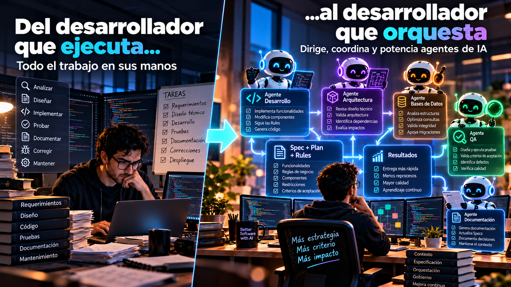
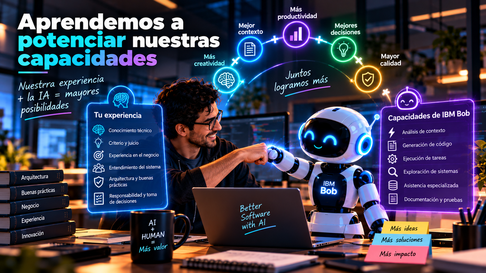

# El desarrollador como orquestador: trabajando con agentes de IA en IBM Bob

**Parte III — Del SDLC al AI-DLC**

Durante muchos años, quienes hemos trabajado en desarrollo de software hemos construido nuestra experiencia aprendiendo lenguajes de programación, arquitecturas, bases de datos, patrones de diseño y diferentes tecnologías, hemos dedicado incontables horas a analizar problemas, escribir código, depurar errores y encontrar soluciones y ahora estamos viviendo una transformación que inevitablemente nos lleva a cuestionarnos:

> **¿Qué sucede con nuestro papel como desarrolladores cuando la Inteligencia Artificial comienza a ejecutar una parte importante de las actividades que tradicionalmente realizábamos nosotros?**

Creo que esta es una de las preguntas más importantes que debemos hacernos en la era agéntica, porque cuando hablamos de herramientas como IBM Bob, muchas veces la conversación gira alrededor de cuánto código pueden generar, cuántas tareas pueden automatizar o cuánto tiempo pueden ahorrarnos, pero desde mi perspectiva, estamos frente a un cambio mucho más profundo:

> **No se trata de competir con IBM Bob, sino de maximizar nuestras capacidades y nuestras posibilidades.**

Y para lograrlo necesitamos transformar nuestra manera de trabajar.

## Ya no se trata solamente de escribir código

En la primera entrega de esta saga hablamos sobre cómo el contexto cambió nuestra forma de trabajar con Inteligencia Artificial, pasamos del autocompletado al prompting y posteriormente a la era agéntica y en la segunda parte profundizamos en cómo **Spec-Driven Development (SDD)** nos permite construir especificaciones que enriquecen el contexto de nuestros agentes y orientan el desarrollo.

Ahora llegamos a un momento particularmente interesante, con el que contamos con los siguientes elementos:

- Tenemos un requerimiento funcional refinado.
- Tenemos un entendimiento técnico de nuestra aplicación.
- Tenemos una Spec validada.
- Tenemos un plan de implementación.
- Y contamos con Rules que establecen los estándares y condiciones bajo los cuales debe trabajar nuestra IA.

Entonces aparece una pregunta:

> **¿Quién debe ejecutar ahora las actividades de desarrollo?**

Tradicionalmente, la respuesta era bastante sencilla: **El desarrollador**. Pero en la era agéntica comenzamos a tener otra posibilidad, podemos asignar actividades concretas a nuestros agentes de IA y acompañarlos durante su ejecución, esto no significa que el desarrollo desaparezca, significa que **las actividades que realizamos dentro del desarrollo comienzan a cambiar** y con ellas, nuestras responsabilidades.

## Del desarrollador que ejecuta al desarrollador que orquesta

Durante años, una parte importante de nuestro trabajo consistió en transformar requerimientos en código, analizábamos una necesidad, diseñábamos una solución y posteriormente implementábamos cada uno de sus componentes, con los agentes de IA, comenzamos a trabajar de una manera diferente.

Ahora podemos dedicar una mayor proporción de nuestro esfuerzo a comprender el problema, analizar la arquitectura, enriquecer el contexto, construir especificaciones y validar decisiones técnicas. Mientras tanto, podemos apoyarnos en nuestros agentes para ejecutar actividades de implementación. Pero aquí quiero destacar algo:

> **No estamos dejando de ser responsables del desarrollo simplemente porque la IA esté generando el código.**

Todo lo contrario, ahora debemos asegurarnos de que aquello que generan nuestros agentes responda correctamente a las necesidades de negocio, respete nuestra arquitectura y cumpla con los estándares de calidad establecidos, para esto se requiere tener:

- Criterio técnico.
- Conocimiento.
- Experiencia.
- Una nueva forma de liderazgo dentro del proceso de desarrollo.

En cierta forma, **nos convertimos en líderes de los desarrollos generados por nuestros agentes de IA**, dejamos de concentrarnos exclusivamente en ejecutar cada tarea y comenzamos a dirigir cómo deben ejecutarse, estamos evolucionando hacia un rol de **orquestadores del desarrollo**.

<figcaption>Fig 1. Del desarrollador que ejecuta al desarrollador que orquesta</figcaption>

## Nuestro nuevo coworker es una Inteligencia Artificial

Hay algo que considero importante cuando hablamos de esta transformación, no deberíamos ver a IBM Bob como un competidor, tampoco deberíamos pensar que la llegada de los agentes significa que nuestros conocimientos y nuestra experiencia dejan de ser relevantes. Creo que debemos comenzar a entender la IA como un nuevo integrante de nuestro entorno de trabajo, un **coworker** con el que necesitamos aprender a colaborar. Durante años hemos trabajado en equipos donde cada integrante aporta conocimientos, capacidades y experiencias diferentes, ahora estamos incorporando un nuevo participante y nuestro programador en par puede ser una Inteligencia Artificial.

Esto cambia la dinámica del trabajo, ya no se trata únicamente de escribir instrucciones para que una herramienta produzca código, se trata de aprender a trabajar conjuntamente con un agente, proporcionarle contexto, establecer objetivos, revisar sus propuestas, cuestionar sus decisiones y validar sus resultados.

> **La IA puede ejecutar actividades, pero nosotros seguimos siendo responsables de orientar el desarrollo hacia el resultado correcto.**

Y para hacerlo necesitamos aprender nuevas formas de colaboración.

<figcaption>Fig 2. Aprendamos a potenciar nuestras capacidades junto a la IA</figcaption>

## La experiencia técnica no pierde valor: cambia dónde la utilizamos

Imaginemos a un desarrollador con 15 o 20 años de experiencia, alguien que ha trabajado durante años con Java, RPG, SQL, arquitectura de software, integración de sistemas y resolución de problemas complejos, es natural que se pregunte:

> **Si ahora IBM Bob puede generar código, ¿qué sucede con todo lo que he aprendido durante mi carrera?**

Mi respuesta sería sencilla:

> **Esa experiencia es precisamente una de las capacidades que necesitamos para aprovechar mejor la Inteligencia Artificial.**

Porque un agente puede generar una solución, pero necesitamos criterio técnico para determinar si esa solución es adecuada, podemos utilizar nuestra experiencia para enriquecer el contexto que proporcionamos a la IA y aplicarlo para lograr:

- Construir mejores Specs.
- Identificar restricciones arquitectónicas.
- Cuestionar decisiones técnicas.
- Detectar riesgos.
- Establecer Rules.
- Y validar que el resultado realmente responde a las necesidades del negocio.

Un desarrollador experimentado no solamente conoce la sintaxis de un lenguaje, conoce las consecuencias de determinadas decisiones, entiende por qué existen ciertos patrones, reconoce problemas que ha enfrentado anteriormente y sabe que una solución puede funcionar técnicamente sin ser necesariamente la mejor solución para un sistema.

> **Todo ese conocimiento adquiere un nuevo valor cuando lo utilizamos para orientar el trabajo de nuestros agentes.**

No se trata de desaprender todo lo que sabemos, se trata de aprender a utilizar ese conocimiento de una manera diferente.

## IBM Bob y los agentes especializados

Aquí es donde el concepto de agentes especializados comienza a resultar particularmente interesante, cuando hablamos de desarrollo de software, sabemos que no todas las actividades requieren exactamente los mismos conocimientos:

1. Un desarrollador especializado en IBM i puede tener un conocimiento profundo de RPG y de las particularidades de esa plataforma.
2. Un desarrollador Java puede dominar otros frameworks, arquitecturas y patrones.
3. Un especialista en bases de datos puede comprender aspectos que no necesariamente forman parte del conocimiento principal de un desarrollador de aplicaciones.
4. Y un profesional de QA puede aportar una perspectiva diferente sobre cómo validar una solución.

Y aquí surge la pregunta: **¿Por qué deberíamos esperar que un único agente ejecute todas estas actividades bajo una misma perspectiva?**

En IBM Bob podemos trabajar con diferentes modos y capacidades especializadas, por ejemplo, dentro de los Premium Packages encontramos alternativas orientadas a diferentes entornos tecnológicos, como **IBM i Developer, Java Developer e IBM i Database**. Esto nos permite comenzar a pensar en una forma de trabajo donde utilizamos capacidades especializadas dependiendo de la actividad que necesitamos realizar, pero lo importante no es solamente disponer de diferentes agentes o modos:

> **Lo verdaderamente interesante es cómo los incorporamos dentro de nuestro proceso de desarrollo.**

Y aquí volvemos a conectar con **AI-DLC**.

## De una tarea compleja a actividades concretas

Recordemos lo que construimos durante la Parte II, ya tenemos una Spec validada y un plan técnico de implementación, ese plan debería permitirnos identificar las actividades necesarias para construir nuestra solución y en lugar de solicitarle a un agente que implemente absolutamente todo mediante una instrucción genérica, podemos comenzar a trabajar con tareas más concretas:

- Cada tarea debería tener un objetivo claro.
- Un contexto definido.
- Restricciones conocidas.
- Criterios de aceptación.
- Y una relación con la especificación que estamos implementando.

Aquí es donde podemos aprovechar las capacidades agénticas para ejecutar actividades de desarrollo, el agente puede analizar el contexto disponible, utilizar las herramientas necesarias y trabajar sobre los componentes involucrados, mientras tanto, el desarrollador puede concentrarse en supervisar el avance, revisar decisiones y validar resultados, pero no debemos confundir autonomía con ausencia de control.

> **Que un agente tenga capacidad para ejecutar una tarea no significa que debamos permitirle tomar cualquier decisión sin supervisión.**

El nivel de autonomía debe responder al riesgo, la complejidad y las condiciones del proyecto, y nuevamente, esto nos lleva al Gobierno.

## Las Rules y el Spec siguen siendo fundamentales

Cuando comenzamos a trabajar con agentes especializados, podríamos pensar que el principal desafío consiste en seleccionar cuál agente utilizar para cada actividad, pero creo que hay algo todavía más importante.

> **Todos deben trabajar bajo un contexto consistente.**

No tendría sentido que un agente de desarrollo implemente una solución utilizando determinados estándares y posteriormente otro agente la valide utilizando criterios completamente diferentes, y tampoco tendría sentido que cada agente interprete de manera independiente los requerimientos de negocio. Por eso necesitamos mantener una referencia compartida, las Rules establecen los estándares y condiciones de trabajo, la Spec describe qué necesitamos construir, el plan técnico establece cómo hemos decidido implementar la solución y los criterios de aceptación permiten determinar si el resultado cumple con lo esperado.

Estos elementos deben orientar el trabajo de nuestros agentes. Porque el verdadero objetivo no es tener múltiples agentes generando resultados independientes. El verdadero objetivo esta en:

> **Lograr que diferentes capacidades de IA colaboren para construir una misma solución bajo objetivos y estándares compartidos.**

## ¿Debería el mismo agente desarrollar y aprobar su propio trabajo?

Aquí aparece una reflexión que considero especialmente importante, incluso si utilizamos un agente para generar código, ¿deberíamos utilizar exactamente el mismo agente para validar que ese código está correcto?, desde mi perspectiva, necesitamos comenzar a pensar en una separación de responsabilidades, en nuestros equipos de desarrollo tradicionalmente hemos reconocido la importancia de contar con diferentes perspectivas, en donde cada rol tiene funciones específicas y complementarias:

1. El desarrollador construye.
2. QA valida.
3. Arquitectura revisa decisiones relevantes.
4. Y las personas responsables del negocio confirman que el resultado responde a sus necesidades.

Con agentes de IA podemos comenzar a explorar una dinámica similar, por ejemplo, podríamos utilizar un agente especializado para implementar una funcionalidad y posteriormente trabajar con otro agente orientado a QA para construir y ejecutar pruebas. Ese agente de QA debería apoyarse en la Spec, las Rules y los criterios de aceptación, su objetivo no debería ser simplemente confirmar que el código generado funciona, debería cuestionar si realmente cumple con lo que necesitamos. Esto también nos permitiría definir expectativas sobre los tipos de pruebas, la cobertura y las condiciones que debemos validar.

Pero quiero destacar algo importante:

> **La separación entre agentes no elimina la necesidad de supervisión humana.**

Tampoco garantiza por sí sola que las pruebas sean independientes o que el resultado sea correcto, necesitamos diseñar adecuadamente cómo trabajan, qué información utilizan y bajo cuáles criterios validan, la IA puede ayudarnos a desarrollar y también a validar, pero la responsabilidad sobre la calidad del software sigue siendo nuestra.

## Cuando QA encuentra un problema, no siempre debemos corregir solamente el código

Imaginemos que durante las pruebas identificamos un defecto, nuestra reacción tradicional podría ser devolver la tarea al desarrollo para corregir el código, pero cuando trabajamos con AI-DLC y SDD, creo que debemos analizar el problema desde una perspectiva más amplia y hacernos los siguientes cuestionamientos:

1. ¿Por qué ocurrió ese defecto?
2. ¿El agente implementó incorrectamente una instrucción?
3. ¿La Spec tenía alguna ambigüedad?
4. ¿Existía un requerimiento que no habíamos considerado?
5. ¿El contexto proporcionado era insuficiente?
6. ¿Alguna Rule necesitaba ser más específica?
7. ¿El plan técnico tenía una omisión?

Estas preguntas son fundamentales, porque si simplemente corregimos el código, podríamos estar resolviendo el síntoma y dejando intacta la causa, en cambio, si identificamos que el problema nació en una etapa anterior, tenemos la oportunidad de mejorar nuestro proceso, lo que nos permitiría:

- Actualizar la Spec.
- Refinar las Rules.
- Enriquecer el contexto.
- Ajustar el plan.

Y evitar que el mismo problema vuelva a repetirse.

> **Cada error debería convertirse en una oportunidad para mejorar la forma en que humanos y agentes trabajamos juntos.**

Aquí comenzamos a comprender que AI-DLC no debería funcionar como una secuencia rígida de actividades, debe permitirnos retroalimentar continuamente el proceso.

## La orquestación también requiere Gobierno

Hasta ahora hemos hablado sobre agentes, Specs, Rules, planes técnicos y validaciones, pero existe algo que conecta todos estos elementos.

> **El Gobierno.**

Cuando incorporamos agentes dentro de nuestro ciclo de desarrollo, necesitamos establecer claramente cuáles son sus responsabilidades:

- Qué actividades pueden ejecutar.
- Qué decisiones pueden tomar.
- Qué restricciones deben respetar.
- Cuándo deben solicitar intervención humana.
- Y cómo vamos a validar los resultados.

No todos los proyectos tienen el mismo nivel de riesgo, no es lo mismo modificar una funcionalidad de bajo impacto que intervenir componentes críticos de una plataforma empresarial. Por eso considero que la autonomía de nuestros agentes debe estar acompañada por mecanismos de supervisión acordes con las necesidades de cada proyecto.

> **La madurez de una organización no debería medirse por cuántas decisiones permite tomar a la IA sin intervención humana, sino por qué tan bien gobierna esas decisiones.**

Y esto también implica transformar nuestros procesos internos, no podemos simplemente incorporar agentes y esperar que todo funcione correctamente manteniendo exactamente las mismas actividades, responsabilidades y formas de trabajo, necesitamos aprender a integrar la IA dentro de nuestros equipos y procesos.

## No competimos con la IA: aprendemos a potenciar nuestras capacidades

Creo que una de las mayores oportunidades que tenemos como desarrolladores es comprender que esta transformación no debería plantearse como una competencia, no se trata de determinar quién escribe código más rápido y tampoco de demostrar que una IA puede hacer en minutos lo que antes nos tomaba horas. La verdadera oportunidad está en comprender cómo podemos aprovechar estas capacidades para hacer mejor nuestro trabajo:

- Nuestra experiencia sigue siendo importante.
- Nuestro conocimiento técnico sigue siendo importante.
- Nuestra capacidad de análisis sigue siendo importante.
- Y nuestra responsabilidad sobre las soluciones que construimos sigue siendo fundamental.

Lo que está cambiando es dónde concentramos nuestros esfuerzos.

> **Antes dedicábamos una parte importante de nuestro tiempo a ejecutar las actividades de desarrollo. Ahora podemos dedicar más esfuerzo a dirigir, validar y mejorar esas actividades con ayuda de nuestros agentes.**

Estamos aprendiendo a trabajar con un nuevo coworker, un programador en par que es una Inteligencia Artificial. Y eso requiere que nosotros también evolucionemos.

## ¿Qué viene después?

En la primera entrega hablamos sobre cómo el contexto cambió nuestra forma de desarrollar software, en la segunda exploramos cómo Spec-Driven Development puede convertir ese contexto en especificaciones que orientan nuestro trabajo y en esta tercera parte vimos cómo el desarrollador comienza a evolucionar hacia un rol de orquestador de agentes de IA. Pero ahora aparece otra pregunta:

> **¿Cómo sabemos que realmente estamos mejorando?**

Podemos tener agentes especializados, podemos construir mejores Specs, podemos establecer Rules, podemos automatizar actividades de desarrollo y validación, pero si no tenemos una forma de medir los resultados, ¿cómo identificamos qué está funcionando y qué necesitamos mejorar?

Aquí volvemos a una idea que considero fundamental:

> **Si no lo podemos medir, no lo podemos mejorar.**

Necesitamos métricas, necesitamos identificar cuellos de botella, necesitamos comprender dónde estamos obteniendo valor y dónde debemos ajustar nuestros procesos, y sobre todo, necesitamos transformar los aprendizajes de cada proyecto en mejoras para nuestra organización. Porque adoptar AI-DLC no significa solamente cambiar cómo desarrollamos software. Significa comenzar a construir una organización capaz de aprender y mejorar continuamente su forma de trabajar con Inteligencia Artificial.

Pero eso será parte de nuestra siguiente entrega.

**Continuará...**

---

> **No se trata solo de modernizar el código, sino de modernizar la forma en que pensamos y trabajamos.**