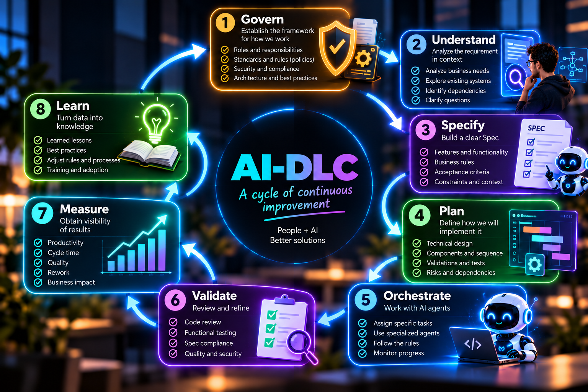
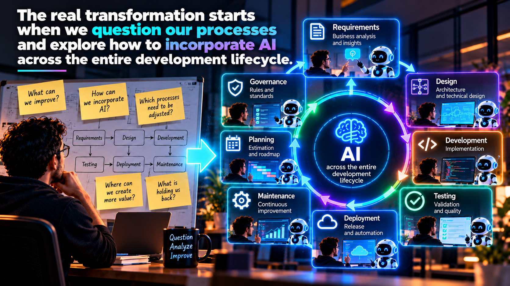

# Governing AI-DLC: measure, learn, and improve

**Part IV — From SDLC to AI-DLC**

During the first three installments of this series, we have explored how artificial intelligence is transforming the way we develop software. We began by discussing the importance of context and how its evolution led us from autocompletion and prompting to the agentic era. Later, we analyzed how **Spec-Driven Development (SDD)** can help us build specifications that allow our agents to better understand what we need to develop. Finally, we reflected on how our role as developers begins to evolve, moving from directly performing many development activities to becoming **orchestrators of artificial intelligence agents**.

But now we reach a question I consider fundamental:

> **How do we know we are really improving?**

Because today we have access to different tools and technologies:

- We can have the best AI tools.
- We can have specialized agents.
- We can build better Specs.
- We can establish Rules.
- And we can automate a significant part of our work.

But if we do not have mechanisms to evaluate the results, it will be difficult to determine whether we are getting the value we expect, because there is something we must always keep in mind:

> **If we cannot measure it, we cannot improve it.**

And this is where Governance becomes the protagonist again.

## AI-DLC begins and ends with Governance

In the first installment of this series, we discussed something I consider especially important:

> **AI-DLC does not begin when we receive a requirement. It begins with Governance.**

Before incorporating agents into our development cycle, we need to establish how we want them to work:

- Our standards.
- Our architectures.
- Our security rules.
- Our processes.
- Our quality criteria.
- And our responsibilities.

With tools such as IBM Bob, we can use capabilities like **Bob Rules** to define instructions and conditions that guide the behavior of our agents. But Governance should not be understood only as an initial activity. Defining our Rules, documenting our standards, and starting to work is not enough; we need to continuously evaluate:

- Whether those rules are working.
- Whether our processes are appropriate.
- Whether we are achieving the expected results.
- And whether there are opportunities for improvement.

That is why I believe AI-DLC should be understood as a cycle that begins with Governance and keeps returning to it.

**Govern → Understand → Specify → Plan → Orchestrate → Validate → Measure → Learn → Govern again.**

Each iteration should enable us to improve the next one.

<figcaption>Fig 1. AI-DLC: A cycle of AI-driven development</figcaption>

## Adopting AI is not the same as transforming our development cycle

One of the mistakes organizations can make is thinking that the adoption of artificial intelligence begins and ends with purchasing tools:

- We buy licenses.
- We assign them to our developers.
- We provide some training.

And we expect productivity to increase. And this is where I usually ask myself the following questions:

- Have we really changed the way we work?
- Have we reviewed our processes?
- Have we identified the activities that can benefit from AI?
- Have we defined how our teams should interact with agents?
- Have we established governance and validation mechanisms?
- Are we measuring the results?

If the answer is no, we are probably using AI tools within a process that continues to function almost the same as before, and that does not necessarily mean we are adopting AI-DLC. From my perspective, **the real transformation begins when we question our processes and look for ways to incorporate AI throughout the entire cycle**.

It is not just a matter of doing faster what we already did; it is about identifying how we can work better.

<figcaption>Fig 2. The transformation begins when we question processes and incorporate AI into our development cycle</figcaption>

## From the question "Can AI do it?" to "How can we do it?"

I think one of the most important cultural changes we need to drive in our organizations is related to how we face the possibilities of AI. Many times, when we start evaluating a tool, we find arguments such as:

- **AI does not understand our architecture.**
- **It does not know our standards.**
- **It does not work with our technology.**
- **It cannot work with our processes.**

And although there may be real limitations, I believe we should begin to ask ourselves the following:

- Are we preparing the context that AI needs appropriately?
- Have we defined our Rules?
- Is our architecture documented?
- Are our requirements clear enough?
- Are our processes ready to incorporate agents?

Instead of starting by asking why we cannot use AI in a given activity, we should try to answer:

> **How can we incorporate AI to improve this process?**

This does not mean ignoring risks or limitations; it means adopting a mindset focused on identifying opportunities, establishing conditions, and building solutions, because often the challenge is not only in the tool, but also in our organizational capacity to adapt to a new way of working.

## Productivity cannot be measured only by speed

When we talk about artificial intelligence applied to development, we usually hear conversations about productivity:

- How much faster can we generate code?
- How many hours can we save?
- How many tasks can an agent perform?
- How much can we reduce development times?

Although these questions are important, I think they are not enough, because developing faster does not necessarily mean developing better. We can generate code in minutes and then spend hours fixing errors. We can complete activities quickly but discover during QA that the requirements were incomplete. We can automate tasks, but generate solutions that do not respect our architectural standards. That is why I believe we should expand the way we understand productivity.

> **Productivity in AI-DLC should not be measured only by execution speed, but by the capacity of our process to deliver value with quality and consistency.**

And to achieve this, we need metrics that allow us to understand what is happening throughout our cycle.

## We need metrics for adoption and results

If we want to govern AI-DLC correctly, we need to establish measurement mechanisms, but we should not measure simply for the sake of measuring. Metrics must help us make decisions. We need to understand where we are truly leveraging our agents' capabilities, where we have bottlenecks, where rework occurs, and which activities require adjustments.

We can begin by evaluating different dimensions:

### AI utilization

We need to understand which activities we are using our agents for and how they are contributing to the process. Not only during development, but also in analysis, documentation, planning, validation, and other activities in the cycle.

### Process efficiency

We must identify how much time the different stages consume and where delays occur, because we could be accelerating code generation enormously while maintaining important bottlenecks in other activities.

### Quality of results

We need to assess whether our implementations meet the requirements, Specs, Rules, and established acceptance criteria.

### Rework

We must identify how many times we need to go back to previous stages and what the causes are:

- Was it an implementation problem?
- An ambiguity in the Spec?
- An incomplete requirement?
- A Rule that was not defined clearly enough?

### Continuous improvement

We also need to understand whether the lessons learned are actually turning into improvements in our processes:

- Are we refining our Rules?
- Are we building better Specs?
- Are we identifying problems earlier?
- Are we eliminating bottlenecks?

These dimensions can help us begin to build a more complete view of AI utilization. But each organization must determine which metrics make sense according to its objectives, maturity level, and project characteristics.

> **The important thing is not to have the largest number of indicators, but to have information that allows us to improve.**

## Bottlenecks also change

There is something I find particularly interesting when we begin to incorporate AI agents. If we manage to accelerate certain activities significantly, we may discover that our main bottlenecks are now in other parts of the process. For example, we could improve implementation times but still face difficulties during requirement refinement, or we could accelerate the construction of a feature while keeping validation processes that are not prepared for the new dynamics. We may also discover that our agents constantly require clarifications because we have not built a sufficiently clear context.

This means we cannot evaluate AI-DLC by looking only at what happens during development.

> **We need to understand the behavior of the entire cycle.**

Because accelerating one activity does not necessarily accelerate the whole process, and if we want to truly improve our delivery capacity, we must identify where the constraints that limit our performance are. This is where metrics become fundamentally valuable, because they allow us to stop working solely on perceptions and begin making decisions based on information.

## When we find an error, we must review more than the code

In Part III, we discussed the importance of incorporating different perspectives during development and validation. For example, we can work with specialized implementation agents and also explore the use of other agents focused on QA. But what happens when we find a defect?

Our first reaction could be to ask the development agent to fix the code. However, I believe that in AI-DLC we should begin to analyze problems from a broader perspective, because not all errors are born during implementation. Some may originate in incomplete requirements, others in ambiguous or insufficient Specs, others in technical context that did not account for certain dependencies, and others in Rules that did not clearly establish the conditions under which the agent should work.

That is why we need to ask ourselves:

> **Are we fixing only the result, or are we also improving the process that produced it?**

This distinction is fundamental, because if we identify that the problem originated in an earlier stage, we have the opportunity to prevent it from happening again. We can refine the requirements, update the Spec, improve our Rules, enrich the context, or adjust our validation process.

> **Every error should become an opportunity to strengthen the way we work.**

## AI-DLC should not become a new Waterfall

When we talk about Governance, Specs, technical plans, and validations, we could interpret this as proposing a return to a rigid and sequential process. But that is not the idea. From my perspective, AI-DLC should be an iterative cycle. We can move forward, validate, identify problems, and return to a previous stage when necessary:

- If during QA we discover an ambiguity in the Spec, we should be able to review it.
- If during development we find a dependency we had not considered, we need to adjust our plan.
- If we identify that a Rule is generating inconsistent behaviors, we should improve it.
- And if our indicators show a bottleneck, we should review the corresponding process.

All of this should occur under governance and validation mechanisms, but without turning each change into an unnecessarily bureaucratic process.

> **Agility and Governance should not compete with each other.**

We can establish standards, responsibilities, and controls without losing our capacity for adaptation, and AI can help us perform many of these activities with greater efficiency.

## Maturity in AI is built through learning

I believe one of the main benefits of working under an AI-DLC approach is our ability to learn continuously:

- Each project can generate knowledge.
- Each Spec can help us understand better how to express our requirements.
- Each validation can show us where we need to improve.
- Each error can reveal an opportunity to refine our Rules.
- And each metric can help us identify an activity that needs optimization.

But that knowledge should not remain only within a single project. We need to turn it into organizational capabilities:

- If we discover a better way to document requirements, we should be able to reuse it in future projects.
- If we identify a Rule that improves the consistency of our developments, we should incorporate it into our standards.
- If we find a more efficient validation process, we should evaluate how to reuse it.

This way, each new initiative can begin from a more mature foundation.

> **AI maturity should not depend only on how capable our agents are, but also on how much our organization learns while working with them.**

And here we return to Governance, because we need mechanisms that allow us to capture, validate, and reuse that learning.

## The transformation is also cultural

We can design the best process, establish excellent Rules, build highly complete Specs, and incorporate specialized agents, but if our organization continues thinking and working exactly the same way, we will hardly leverage the full potential of this transformation. Adopting AI-DLC implies reviewing:

- How we collaborate.
- How we make decisions.
- How we share knowledge.
- How we define responsibilities.
- And how we understand our role within the development cycle.

It also means accepting that many of the activities we previously performed may change and that we will need to develop new capabilities to work with our agents. This is not about eliminating the knowledge we have built over the years, but about using it in a different way.

> **Our experience should help us strengthen the context, the Specs, the Rules, and the decisions that guide AI work.**

And that requires a culture where we are willing to learn, question, and continuously improve.

## It is not only about developing software faster

After walking through these four installments, I think we can return to the question that gave rise to this reflection: **What is really changing with artificial intelligence in software development?**

At first, it seemed like the answer was simple: AI would allow us to generate code faster. But as we began exploring its capabilities, we discovered that the change was much deeper. Context began to gain enormous importance. Specifications began to become a fundamental tool for guiding our agents. Our role as developers began to evolve toward orchestration. And Governance became the element that connects all of these activities.

Now we need to learn how to measure results, identify opportunities, and improve continuously, because **AI-DLC should not be understood only as a way to accelerate software development**. It should be understood as an opportunity to transform how our organizations analyze, design, build, validate, and improve their technological solutions.

## Final reflection: the real change is us

During this saga, we have talked about tools, agents, Specs, Rules, processes, and metrics. But I want to close with a reflection: artificial intelligence will continue to evolve, its capabilities will become increasingly greater, and many of the activities we perform today in a certain way will continue to transform. However, I believe the greatest challenge will not be exclusively our ability to adopt new tools, but our willingness to transform the way we think and work, to learn to collaborate with AI agents, to use our experience to build better contexts, to use specifications to express our intention clearly, to govern our decisions, and to measure our results in order to learn and improve.

Because in the end, **the true transformation is not about having agents capable of generating more code, but about building organizations capable of leveraging artificial intelligence to deliver better solutions**.

And if we want to achieve that, we must begin with ourselves:

> **It is not just about modernizing the code, but also about modernizing the way we think and work.**