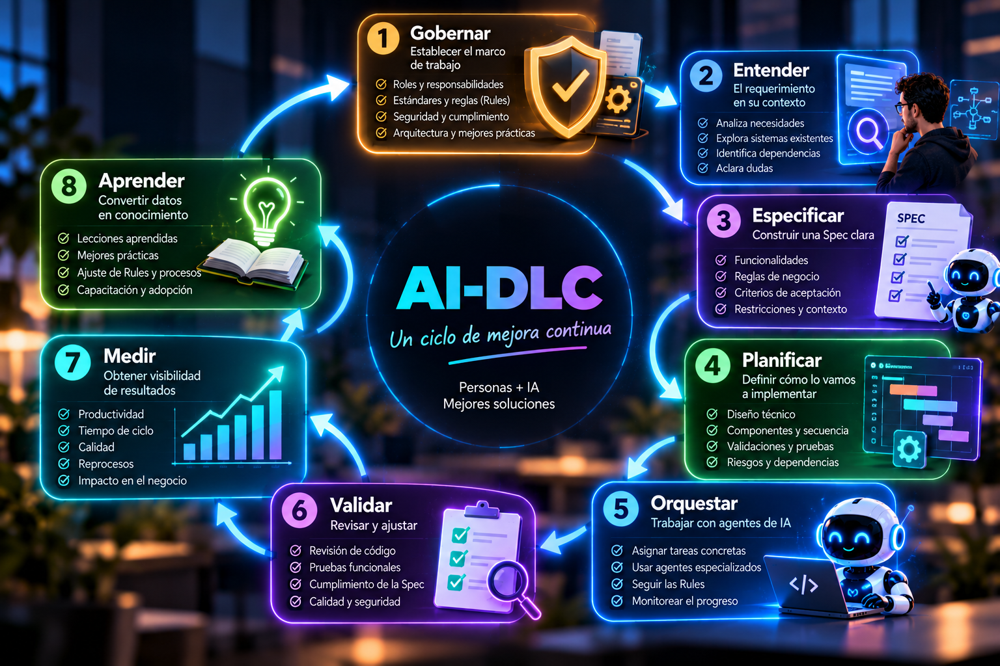
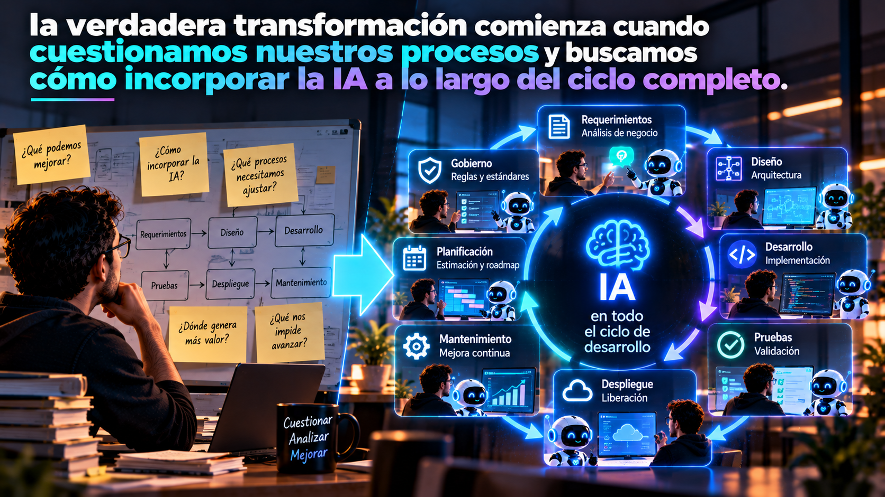

# Gobernar el AI-DLC: medir, aprender y mejorar

**Parte IV — Del SDLC al AI-DLC**

Durante las primeras tres entregas de esta saga hemos explorado cómo la Inteligencia Artificial está transformando nuestra manera de desarrollar software, comenzamos hablando sobre la importancia del contexto y cómo su evolución nos llevó desde el autocompletado y el prompting hacia la era agéntica; posteriormente analizamos cómo **Spec-Driven Development (SDD)** puede ayudarnos a construir especificaciones que permitan a nuestros agentes comprender mejor qué necesitamos desarrollar; y finalmente reflexionamos sobre cómo nuestro papel como desarrolladores comienza a evolucionar, pasando de ejecutar directamente muchas de las actividades de desarrollo a convertirnos en **orquestadores de agentes de Inteligencia Artificial**.

Pero ahora llegamos a una pregunta que considero fundamental:

> **¿Cómo sabemos que realmente estamos mejorando?**

Porque hoy en día tenemos acceso a diferentes herramientas y tecnologías:

- Podemos tener las mejores herramientas de IA.
- Podemos contar con agentes especializados.
- Podemos construir mejores Specs.
- Podemos establecer Rules.
- Y podemos automatizar una parte importante de nuestras actividades.

Pero si no tenemos mecanismos para evaluar los resultados, difícilmente podremos determinar si estamos obteniendo el valor que esperamos, porque hay algo que siempre debemos tener presente:

> **Si no lo podemos medir, no lo podemos mejorar.**

Y aquí es donde el Gobierno vuelve a convertirse en el protagonista.

## AI-DLC comienza y termina con Gobierno

En la primera entrega de esta saga hablamos sobre algo que considero especialmente importante:

> **AI-DLC no comienza cuando recibimos un requerimiento. Comienza con Gobierno.**

Antes de incorporar agentes dentro de nuestro ciclo de desarrollo, necesitamos establecer cómo queremos que trabajen:

- Nuestros estándares.
- Nuestras arquitecturas.
- Nuestras reglas de seguridad.
- Nuestros procesos.
- Nuestros criterios de calidad.
- Y nuestras responsabilidades.

Con herramientas como IBM Bob podemos utilizar capacidades como **Bob Rules** para establecer instrucciones y condiciones que orienten el comportamiento de nuestros agentes, pero el Gobierno no debería entenderse únicamente como una actividad inicial, no basta con definir nuestras Rules, documentar nuestros estándares y comenzar a trabajar, necesitamos evaluar continuamente:

- Si esas reglas están funcionando.
- Si nuestros procesos son adecuados.
- Si estamos obteniendo los resultados esperados.
- Y si existen oportunidades para mejorar.

Por eso considero que AI-DLC debe entenderse como un ciclo que comienza con Gobierno y vuelve continuamente a él.

**Gobernar → Entender → Especificar → Planificar → Orquestar → Validar → Medir → Aprender → Gobernar nuevamente.**

Cada iteración debería permitirnos mejorar la siguiente.

<figcaption>Fig 1. AI-DLC Un Ciclo de Desarrollo con IA</figcaption>

## Adoptar IA no es lo mismo que transformar nuestro ciclo de desarrollo

Uno de los errores que podemos cometer como organizaciones es pensar que la adopción de Inteligencia Artificial comienza y termina con la adquisición de herramientas:

- Compramos licencias.
- Las asignamos a nuestros desarrolladores.
- Ofrecemos algunas capacitaciones.

Y esperamos que la productividad aumente, y ahí es donde suelo hacerme las siguientes preguntas:

- ¿Realmente hemos cambiado nuestra forma de trabajar?
- ¿Hemos revisado nuestros procesos?
- ¿Hemos identificado las actividades que pueden beneficiarse de la IA?
- ¿Hemos definido cómo deben interactuar nuestros equipos con los agentes?
- ¿Hemos establecido mecanismos de gobierno y validación?
- ¿Estamos midiendo los resultados?

Si la respuesta es no, probablemente estamos utilizando herramientas de IA dentro de un proceso que sigue funcionando prácticamente igual que antes y eso no necesariamente significa que estemos adoptando AI-DLC, desde mi perspectiva, **la verdadera transformación comienza cuando cuestionamos nuestros procesos y buscamos cómo incorporar la IA a lo largo del ciclo completo**.

No se trata solamente de hacer más rápido lo que ya hacíamos, se trata de identificar cómo podemos trabajar mejor.

<figcaption>Fig 2. La transformación comienza cuando cuestionamos procesos e incorporamos IA en nuestro ciclo de desarrollo</figcaption>

## De la pregunta "¿Puede la IA hacerlo?" al "¿Cómo sí podemos hacerlo?"

Creo que uno de los cambios culturales más importantes que necesitamos impulsar dentro de nuestras organizaciones está relacionado con la forma en que enfrentamos las posibilidades de la IA. Muchas veces, cuando comenzamos a evaluar una herramienta, nos encontramos con argumentos como:

- **La IA no entiende nuestra arquitectura.**
- **No conoce nuestros estándares.**
- **No funciona con nuestra tecnología.**
- **No puede trabajar con nuestros procesos.**

Y aunque pueden existir limitaciones reales, creo que debemos comenzar a cuestionarnos lo siguiente:

- ¿Estamos preparando adecuadamente el contexto que necesita la IA?
- ¿Hemos definido nuestras Rules?
- ¿Tenemos documentada nuestra arquitectura?
- ¿Nuestros requerimientos son suficientemente claros?
- ¿Nuestros procesos están preparados para incorporar agentes?

En lugar de comenzar preguntándonos por qué no podemos utilizar IA en determinada actividad, deberíamos intentar responder:

> **¿Cómo sí podemos incorporar la IA para mejorar este proceso?**

Esto no significa ignorar riesgos o limitaciones, significa adoptar una mentalidad orientada a identificar oportunidades, establecer condiciones y construir soluciones, porque muchas veces el desafío no está solamente en la herramienta, también está en nuestra capacidad organizacional para adaptarnos a una nueva forma de trabajar.

## La productividad no puede medirse solamente por la velocidad

Cuando hablamos de Inteligencia Artificial aplicada al desarrollo, normalmente escuchamos conversaciones sobre productividad:

- ¿Cuánto más rápido podemos generar código?
- ¿Cuántas horas podemos ahorrar?
- ¿Cuántas tareas puede ejecutar un agente?
- ¿Cuánto podemos reducir los tiempos de desarrollo?

Y aunque estas preguntas son importantes, creo que no son suficientes, porque desarrollar más rápido no necesariamente significa desarrollar mejor, podemos generar código en minutos y posteriormente invertir horas corrigiendo errores, podemos completar actividades rápidamente, pero descubrir durante QA que los requerimientos estaban incompletos, podemos automatizar tareas, pero generar soluciones que no respeten nuestros estándares arquitectónicos. Por eso considero que debemos ampliar nuestra manera de entender la productividad.

> **La productividad en AI-DLC no debería medirse solamente por la velocidad de ejecución, sino por la capacidad de nuestro proceso para entregar valor con calidad y consistencia.**

Y para lograrlo necesitamos métricas que nos permitan comprender qué está ocurriendo a lo largo de nuestro ciclo.

## Necesitamos métricas de aprovechamiento y de resultados

Si queremos gobernar correctamente AI-DLC, necesitamos establecer mecanismos de medición, pero no deberíamos medir simplemente por medir, las métricas deben ayudarnos a tomar decisiones, necesitamos comprender dónde estamos aprovechando realmente las capacidades de nuestros agentes, dónde tenemos cuellos de botella, dónde se producen los reprocesos y cuáles actividades requieren ajustes.

Podemos comenzar evaluando diferentes dimensiones:

### Aprovechamiento de la IA

Necesitamos comprender en cuáles actividades estamos utilizando nuestros agentes y cómo están contribuyendo al proceso. No solamente durante el desarrollo, sino también en análisis, documentación, planificación, validación y otras actividades del ciclo.

### Eficiencia del proceso

Debemos identificar cuánto tiempo consumen las diferentes etapas y dónde se presentan retrasos, porque podríamos estar acelerando enormemente la generación de código mientras mantenemos cuellos de botella importantes en otras actividades.

### Calidad de los resultados

Necesitamos evaluar si nuestras implementaciones cumplen con los requerimientos, las Specs, las Rules y los criterios de aceptación establecidos.

### Reprocesos

Debemos identificar cuántas veces necesitamos regresar a etapas anteriores y cuáles son las causas:

- ¿Fue un problema de implementación?
- ¿Una ambigüedad en la Spec?
- ¿Un requerimiento incompleto?
- ¿Una Rule que no estaba suficientemente definida?

### Mejora continua

También necesitamos comprender si los aprendizajes obtenidos están convirtiéndose realmente en mejoras para nuestros procesos:

- ¿Estamos refinando nuestras Rules?
- ¿Estamos construyendo mejores Specs?
- ¿Estamos identificando problemas antes?
- ¿Estamos eliminando cuellos de botella?

Estas dimensiones pueden ayudarnos a comenzar a construir una visión más completa del aprovechamiento de la IA. Pero cada organización deberá determinar cuáles métricas tienen sentido según sus objetivos, su nivel de madurez y las características de sus proyectos.

> **Lo importante no es tener la mayor cantidad de indicadores, sino contar con información que nos permita mejorar.**

## Los cuellos de botella también cambian

Hay algo que considero particularmente interesante cuando comenzamos a incorporar agentes de IA. Si logramos acelerar considerablemente determinadas actividades, podemos descubrir que nuestros principales cuellos de botella ahora están en otras partes del proceso. Por ejemplo, podríamos mejorar los tiempos de implementación, pero continuar teniendo dificultades durante el refinamiento de requerimientos o podríamos acelerar la construcción de una funcionalidad, pero mantener procesos de validación que no están preparados para trabajar con la nueva dinámica, y también podríamos descubrir que nuestros agentes requieren constantemente aclaraciones porque no hemos construido un contexto suficientemente claro.

Esto significa que no podemos evaluar AI-DLC observando únicamente lo que sucede durante el desarrollo.

> **Necesitamos comprender el comportamiento del ciclo completo.**

Porque acelerar una actividad no necesariamente acelera todo el proceso y si queremos mejorar realmente nuestra capacidad de entrega, debemos identificar dónde están las restricciones que limitan nuestro desempeño, aquí las métricas adquieren un valor fundamental, nos permiten dejar de trabajar exclusivamente sobre percepciones y comenzar a tomar decisiones basadas en información.

## Cuando encontramos un error, debemos revisar algo más que el código

En la Parte III hablamos sobre la importancia de incorporar diferentes perspectivas durante el desarrollo y la validación, por ejemplo, podemos trabajar con agentes especializados en implementación y explorar el uso de otros agentes orientados a QA, pero ¿qué sucede cuando encontramos un defecto?

Nuestra primera reacción podría ser solicitarle al agente de desarrollo que corrija el código, sin embargo, creo que en AI-DLC debemos comenzar a analizar los problemas desde una perspectiva más amplia, porque no todos los errores necesariamente nacen durante la implementación, algunos pueden originarse en requerimientos incompletos, otros en Specs ambiguas o insuficientes, otros en un contexto técnico que no contemplaba determinadas dependencias y otros en Rules que no establecían claramente las condiciones bajo las cuales debía trabajar el agente.

Por eso necesitamos preguntarnos:

> **¿Estamos corrigiendo solamente el resultado o estamos mejorando también el proceso que produjo ese resultado?**

Esta diferencia es fundamental, porque si identificamos que el problema se originó en una etapa anterior, tenemos la oportunidad de evitar que vuelva a repetirse, podemos refinar los requerimientos, actualizar la Spec, mejorar nuestras Rules, enriquecer el contexto o ajustar nuestro proceso de validación.

> **Cada error debería convertirse en una oportunidad para fortalecer nuestra forma de trabajar.**

## AI-DLC no debería convertirse en un nuevo Waterfall

Cuando hablamos de Gobierno, Specs, planes técnicos y validaciones, podríamos interpretar que estamos proponiendo regresar a un proceso rígido y secuencial, pero esa no es la idea, desde mi perspectiva, AI-DLC debe ser un ciclo iterativo, podemos avanzar, validar, identificar problemas y regresar a una etapa anterior cuando sea necesario:

- Si durante QA descubrimos una ambigüedad en la Spec, debemos poder revisarla.
- Si durante el desarrollo encontramos una dependencia que no habíamos considerado, necesitamos ajustar nuestro plan.
- Si identificamos que una Rule está generando comportamientos inconsistentes, debemos mejorarla.
- Y si nuestros indicadores muestran que existe un cuello de botella, debemos revisar el proceso correspondiente.

Todo esto debe ocurrir bajo mecanismos de Gobierno y validación, pero sin convertir cada cambio en un proceso innecesariamente burocrático.

> **La agilidad y el Gobierno no deberían competir entre sí.**

Podemos establecer estándares, responsabilidades y controles sin perder nuestra capacidad de adaptación y la IA puede ayudarnos a realizar muchas de estas actividades con mayor eficiencia.

## La madurez en IA se construye con aprendizaje

Creo que uno de los principales beneficios de trabajar bajo un enfoque AI-DLC está en nuestra capacidad para aprender continuamente:

- Cada proyecto puede generar conocimiento.
- Cada Spec puede ayudarnos a comprender mejor cómo expresar nuestros requerimientos.
- Cada validación puede mostrarnos dónde necesitamos mejorar.
- Cada error puede revelar una oportunidad para refinar nuestras Rules.
- Y cada métrica puede ayudarnos a identificar una actividad que necesita ser optimizada.

Pero ese conocimiento no debería quedarse solamente dentro de un proyecto, necesitamos convertirlo en capacidades organizacionales:

- Si descubrimos una mejor manera de documentar requerimientos, deberíamos poder aprovecharla en proyectos futuros.
- Si identificamos una Rule que mejora la consistencia de nuestros desarrollos, deberíamos incorporarla a nuestros estándares.
- Si encontramos un proceso de validación más eficiente, deberíamos evaluar cómo reutilizarlo.

De esta manera, cada nueva iniciativa puede comenzar desde una base más madura.

> **La madurez en IA no debería depender solamente de qué tan capaces son nuestros agentes, sino también de cuánto aprende nuestra organización al trabajar con ellos.**

Y aquí volvemos nuevamente al Gobierno, porque necesitamos mecanismos que permitan capturar, validar y reutilizar ese aprendizaje.

## La transformación también es cultural

Podemos diseñar el mejor proceso, podemos establecer excelentes Rules, podemos construir Specs muy completas y podemos incorporar agentes especializados, pero si nuestra organización continúa pensando y trabajando exactamente de la misma manera, difícilmente aprovecharemos todo el potencial de esta transformación. Adoptar AI-DLC implica revisar:

- Cómo colaboramos.
- Cómo tomamos decisiones.
- Cómo compartimos conocimiento.
- Cómo definimos responsabilidades.
- Y cómo entendemos nuestro papel dentro del ciclo de desarrollo.

También implica aceptar que muchas de las actividades que realizábamos anteriormente pueden cambiar y que necesitaremos desarrollar nuevas capacidades para trabajar con nuestros agentes, no se trata de eliminar el conocimiento que hemos construido durante años, se trata de aprovecharlo de una manera diferente.

> **Nuestra experiencia debe ayudarnos a potenciar el contexto, las Specs, las Rules y las decisiones que orientan el trabajo de la IA.**

Y eso requiere una cultura donde estemos dispuestos a aprender, cuestionar y mejorar continuamente.

## No se trata solamente de desarrollar software más rápido

Después de recorrer estas cuatro entregas, creo que podemos volver a la pregunta que dio origen a toda esta reflexión, **¿Qué está cambiando realmente con la Inteligencia Artificial en el desarrollo de software?**

Al principio parecía que la respuesta era sencilla, la IA nos permitiría generar código más rápido, pero conforme comenzamos a explorar sus capacidades, descubrimos que el cambio era mucho más profundo, el contexto comenzó a adquirir una importancia enorme. Las especificaciones comenzaron a convertirse en una herramienta fundamental para orientar a nuestros agentes, nuestro papel como desarrolladores comenzó a evolucionar hacia la orquestación y el Gobierno se convirtió en el elemento que conecta todas estas actividades.

Ahora necesitamos aprender a medir los resultados, identificar oportunidades y mejorar continuamente, porque **AI-DLC no debería entenderse solamente como una forma de acelerar el desarrollo de software**, debería entenderse como una oportunidad para transformar cómo nuestras organizaciones analizan, diseñan, construyen, validan y mejoran sus soluciones tecnológicas.

## Reflexión final: el verdadero cambio somos nosotros

Durante esta saga hemos hablado sobre herramientas, agentes, Specs, Rules, procesos y métricas, pero quiero cerrar con una reflexión, la Inteligencia Artificial seguirá evolucionando, sus capacidades serán cada vez mayores y probablemente muchas de las actividades que hoy realizamos de una determinada manera continuarán transformándose, sin embargo, creo que el mayor desafío no estará exclusivamente en nuestra capacidad para adoptar nuevas herramientas, estará en nuestra disposición para transformar la manera en que pensamos y trabajamos, en aprender a colaborar con agentes de IA, en aprovechar nuestra experiencia para construir mejores contextos, en utilizar las especificaciones para expresar claramente nuestra intención, en gobernar nuestras decisiones y en medir nuestros resultados para aprender y mejorar.

Porque al final, **la verdadera transformación no consiste en tener agentes capaces de generar más código, sino en construir organizaciones capaces de aprovechar la Inteligencia Artificial para entregar mejores soluciones**.

Y si queremos lograrlo, debemos comenzar por nosotros mismos:

> **No se trata solo de modernizar el código, sino de modernizar la forma en que pensamos y trabajamos.**